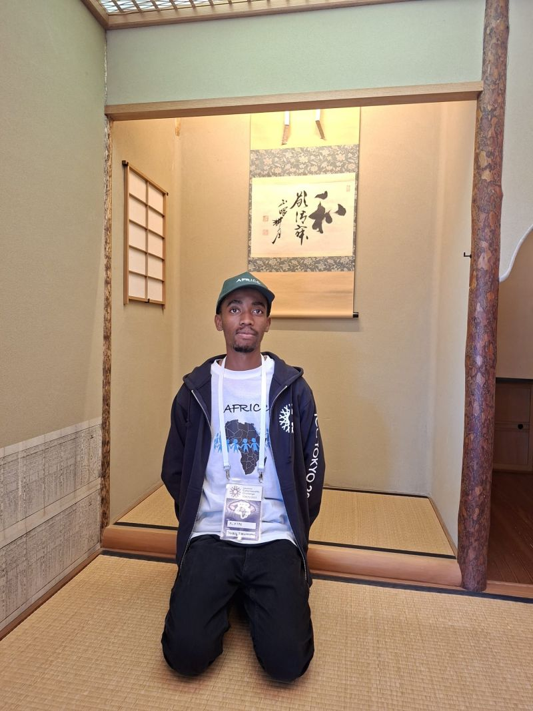

<!-- BANNER - terminal profile.sh --live (additive). Generated by scripts/banner/generate.py.
     ~0.7–0.8 MB each. Cache-bust with ?v=N after regenerating. -->
<picture>
  <source media="(prefers-color-scheme: dark)"  srcset="assets/banner-dark.v9.svg">
  <source media="(prefers-color-scheme: light)" srcset="assets/banner-light.v9.svg">
  
</picture>

 

<!-- PROFILE PICTURE - original photo, used as-is (unedited) -->

 

<!-- NAME / TAGLINE - animated typing -->

 

<!-- SOCIALS — LinkedIn & TryHackMe only -->
&nbsp;&nbsp;

 

---

## This is me :)

Hi, I'm **Thabiso**, a Cyber Security Intelligence Analyst from **Lesotho** 🇱🇸.
I turn raw security data into actionable intelligence and strengthen organisational cyber posture.

- 🎯 **Cyber Security Analyst (Intern)** at **The Root Access Network (T.R.A.N)** — penetration testing, vulnerability assessments, log analysis, and automated security tooling.
- 🏆 **#1 All-Time Rank on TryHackMe in Lesotho** — *1amAizen* — complex security challenges, threat analysis methodologies, peer mentoring.
- 🌍 **Team Representative for Africa** at the **International Cybersecurity Challenge (ICC) 2025 Finals** in Tokyo — placed **7th globally** in the Jeopardy-style CTF and competed in Attack-&-Defense.
- 🥇 **Internet Society Cyber Security Hackathon** — 1st Place (2024), 3rd Place (2025).
- 📜 **Certifications**: CompTIA PenTest+ • Jr Penetration Tester (TryHackMe) • Machine Learning Specialization (Stanford / DeepLearning.AI).
- 🎓 **BSc Mathematics & Computer Science** — National University of Lesotho (2026).
- 💬 Talk to me about **threat intelligence**, **penetration testing**, **OSINT**, **incident response**, or **CTF strategy**.

 

## my security stack

---

## signals

<table>
<tr>
<td width="50%" align="center" valign="middle">

<!-- Self-rated radar - edit assets/skills.json, the Charts workflow redraws it -->
<picture>
  <source media="(prefers-color-scheme: dark)"  srcset="assets/radar-dark.svg">
  <source media="(prefers-color-scheme: light)" srcset="assets/radar-light.svg">
  
</picture>

</td>
<td width="50%" align="center" valign="middle">

<!-- Hand-authored security tooling & language stack radar - edit assets/langmix.json -->
<picture>
  <source media="(prefers-color-scheme: dark)"  srcset="assets/radar-langs-dark.svg">
  <source media="(prefers-color-scheme: light)" srcset="assets/radar-langs-light.svg">
  
</picture>

</td>
</tr>
</table>

---

## experience

### Cyber Security Analyst (Intern)
**The Root Access Network (T.R.A.N)** &nbsp;·&nbsp; *June 2026 – Present*

- Conduct penetration tests and vulnerability assessments across internal networks and web applications.
- Analyse security logs and alerts to identify threats, anomalies, and indicators of compromise.
- Collaborate with the team to develop automated security scanning scripts.
- Document findings and present actionable remediation recommendations to strengthen security posture.

### Team Representative — Africa
**International Cybersecurity Challenge (AFRICC)** &nbsp;·&nbsp; *August 2025 – Present*

- Represented Africa at the ICC 2025 Finals in Tokyo, Japan, placing **7th globally** in the Jeopardy-style CTF.
- Competed in the Attack-&-Defense CTF, with a focus on threat intelligence, network forensics, and real-time adversary analysis.
- Analysed attack patterns and delivered effective responses under pressure.

### Cyber Security Intelligence Analyst (Intern)
**Ministry of Information, Communications, Science, Technology and Innovation, Lesotho** &nbsp;·&nbsp; *June 2025 – August 2025*

- Monitored internal systems for suspicious activity and performed initial threat analysis.
- Assisted with vulnerability assessments and produced intelligence briefs for infrastructure support teams.
- Logged and tracked security incidents, ensuring timely escalation and resolution.
- Contributed to the security hardening of digital systems within the Infrastructure Support Services Office.

### CTF Player & Security Analyst
**TryHackMe** (*1amAizen*) &nbsp;·&nbsp; *January 2023 – August 2025*

- Ranked **#1 all-time in Lesotho** through consistent solving of complex security challenges and the development of structured threat analysis methodologies.
- Established a repeatable process for technical incident investigation: log review, vulnerability identification, and root cause analysis.
- Mentored peers on cyber intelligence concepts and platform-related security topics.

---

## key achievements

| | Achievement | Details | Year |
|:-:|:--|:--|:-:|
| 🌍 | **International Cybersecurity Challenge — Finals, Tokyo** | Team Representative for Africa · **7th globally** (Jeopardy CTF) | 2025 |
| 🥇 | **Internet Society Cyber Security Hackathon** | **1st Place** | 2024 |
| 🥉 | **Internet Society Cyber Security Hackathon** | **3rd Place** | 2025 |
| 🏆 | **TryHackMe — Lesotho** | **#1 All-Time Rank** (*1amAizen*) | 2023 – Present |
| 📜 | **CompTIA PenTest+** · **Jr Penetration Tester** | Offensive security certifications | 2025 |
| 🎓 | **Machine Learning Specialization** | Stanford University & DeepLearning.AI | 2025 |

---

## education & certifications

**BSc Mathematics & Computer Science** — National University of Lesotho *(2021 – 2026)*
*Relevant coursework: Computer Networks, Operating Systems, Database Management, Cybersecurity Fundamentals, System Administration.*

**Certifications**
- CompTIA PenTest+ — TryHackMe (2025)
- Jr Penetration Tester — TryHackMe (2025)
- Machine Learning Specialization — Stanford University & DeepLearning.AI (2025)

---

## volunteering

**Referee & Setup Team Member** — *AI for Good Challenge* &nbsp;·&nbsp; *March – April 2025*

- Guided students on competition rules, strengthening communication and analytical explanation skills.
- Handled technical setup and troubleshooting, reinforcing customer-facing problem solving.

---

Built with precision · Thabiso Thelingoane · Lesotho 🇱🇸

